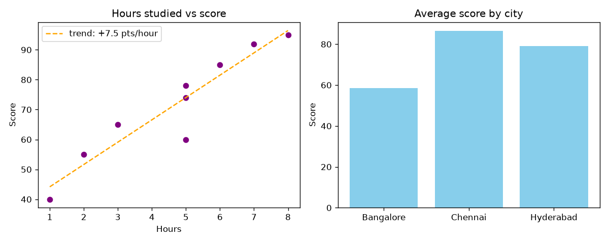
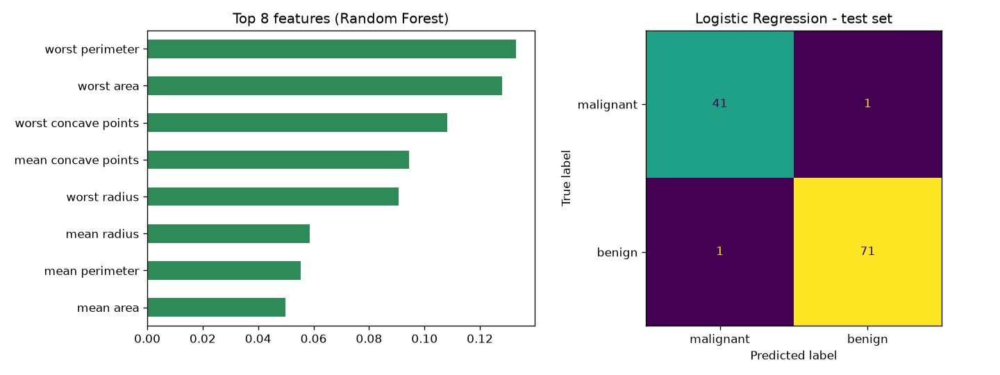

# 🤖 AI Learning Journey


My from-scratch path into **AI, Machine Learning, and LLMs**: small steps, runnable code, and notes on what I learned at each stage.

## 🗺️ Roadmap

| # | Stage | What I'm learning | Status |
|---|-------|-------------------|--------|
| 01 | [Python & data basics](01-python-basics) | Python, NumPy, pandas, matplotlib | ✅ Complete |
| 02 | [Math for ML](02-math-for-ml) | Vectors, matrices, derivatives, gradient descent, probability | ✅ Complete |
| 03 | [Classic ML](03-classic-ml) | Regression, classification, scikit-learn, evaluation | 🟡 In progress |
| 04 | Deep learning (PyTorch) | Neural nets, training loops, CNNs | ⚪ Planned |
| 05 | LLMs | Tokens, transformers, prompting, LLM APIs | ⚪ Planned |
| 06 | RAG | Embeddings, vector search, chat-with-your-docs | ⚪ Planned |
| 07 | AI agents | Tool use, planning, multi-step agents | ⚪ Planned |
| 08 | Fine-tuning & deployment | LoRA fine-tuning, FastAPI, Docker, hosting | ⚪ Planned |

## 🏁 Mini-projects so far

**Study data analysis** (Stage 1): cleans a messy dataset and finds what drives scores. [Code](01-python-basics/14_mini_project_study_analysis.py)


**Tumor classifier** (Stage 3): an end-to-end scikit-learn pipeline, 98% test accuracy with logistic regression. [Code](03-classic-ml/04_project_breast_cancer_classifier.py)


**Gradient descent from scratch** (Stage 2): fits a line using only NumPy and calculus. [Code](02-math-for-ml/04_gradient_descent.py)

## 🚀 Planned capstone projects
- **DocChat**: chat with your PDFs (RAG, Python + TypeScript web UI)
- **ResumeMatch AI**: scores a resume against a job description and suggests edits
- **Research Agent**: an agent that searches a topic and writes a report
- **Ticket Router**: fine-tuned text classifier with an evaluation report
- **Vision Demo**: image classifier (e.g. plant disease) with a web interface

## ▶️ Run the code
```bash
git clone https://github.com/nikithareddy2098/ai-learning-journey.git
cd ai-learning-journey
pip install -r requirements.txt
python 01-python-basics/14_mini_project_study_analysis.py
python 02-math-for-ml/04_gradient_descent.py
python 03-classic-ml/04_project_breast_cancer_classifier.py
```

📒 Daily log: [PROGRESS.md](PROGRESS.md)
